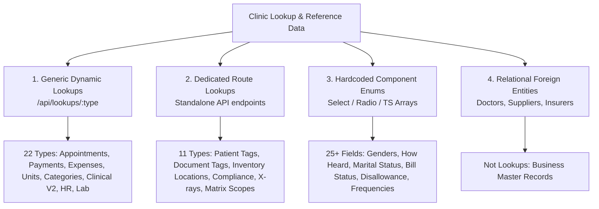

# Comprehensive Lookups Audit & Master CSV Specification
**Portals Application & Backend Infrastructure — Framada Clinic**

---

## 1. Executive Summary

This audit evaluates all lookup and selectable reference fields across the entire **Portals** application (`portals/src`), cross-referenced against the backend schema (`backend/src/db/schema`), API endpoints (`backend/src/routes/lookups.ts`), and database migrations.

### Key Findings
1. **Three Divergent Lookup Architectures Currently Coexist**:
   - **Generic Dynamic Lookups (`/api/lookups/:type`)**: 22 lookup types unified behind a single Hono route with shared `LookupRow` shape (`id, name, displayName, colour, isActive`) and TanStack Query cache invalidation (`useLookup`, `useLookupAdmin`, `LookupMultiSelect`).
   - **Dedicated Entity/Settings Endpoints**: 11 lookup-like reference tables (`patient_tags`, `document_tags`, `inventory_locations`, `compliance_categories`, `consent_templates`, `xray_types`, `app_payment_methods`, `application_scopes`, `tooth_classes`, `request_kinds`, `request_subtypes`) running on standalone routes with custom schemas.
   - **Hardcoded / Static Enums**: Over 25 UI dropdowns (patient gender, referral source "how did you hear", marital status, appointment statuses, discount types, stock movement types, payment plan frequencies, etc.) currently hardcoded in React components or type packages (`@framada/types`).
2. **Current Export/Import Limitations**:
   - **JSON Settings Export** (`/api/settings/export`): Exports a subset (26 tables) as a single JSON file, but lacks a human-editable CSV format and omits key lookups like `categories`, `lab_case_statuses`, and `compliance_tags`.
   - **Per-Table CSV Tools** (`Database Management`): Supports CSV template download and upload, but strictly **one table at a time**, requiring dozens of manual file uploads to set up a new clinic.
3. **The Solution**:
   - A unified **Master Lookups Schema** (`master_lookups.csv`) that captures all dynamic, dedicated, and configurable lookup fields in a single CSV file.
   - A curated 162-row seed dataset ready for one-go import/export.

---

## 2. Global Lookups Classification



---

## 3. Comprehensive Lookups Inventory Matrix

The table below catalogs every lookup across the Portals app:

| Lookup Slug (`lookup_type`) | Domain / Feature | Storage Table | Endpoint | Management UI (Settings) | Portals Consumer Components / Forms | Special Columns / Constraints |
| :--- | :--- | :--- | :--- | :--- | :--- | :--- |
| `appointment-types` | Scheduling | `appointment_types` | `/api/lookups/appointment-types` | `appointment-types-section.tsx` | `appointment-calendar.tsx`, `add-appointment-dialog.tsx`, `appointment-detail-dialog.tsx`, `website-bookings-panel.tsx`, `appointment-reminders-section.tsx` | `colour` (hex `#94A3B8`) |
| `treatment-types` | Clinical / Billing | `treatment_types` | `/api/lookups/treatment-types` | `ClinicalLookupSection` | `clinical-treatment-plan-sheet.tsx`, `create-treatment-plan-sheet.tsx`, `treatment-plan-editor.tsx`, `treatment-plan-present-dialog.tsx` | `autoSyncEnabled`, `defaultRecareMonths`, `adaGroup` |
| `examination-types` | Clinical / Stages | `examination_types` | `/api/lookups/examination-types` | `examination-types-section.tsx` | `examination-stage.tsx`, `clinical-cases-tab.tsx`, `caseStages.data.examTypeId` | Standard lookup shape |
| `expense-categories` | Finance & Billing | `expense_categories` | `/api/lookups/expense-categories` | `expense-categories-section.tsx` | `add-expense-sheet.tsx`, `edit-expense-sheet.tsx`, `petty-settings-tab.tsx`, `petty-cash-policy-section.tsx`, `ledger-adjustments/pages/index.tsx` | `isPettyCash`, `pettyRefType` (`service_provider\|staff\|specialist\|none`), `accountId` (GL FK) |
| `payment-methods` | Finance & Billing | `payment_methods` | `/api/lookups/payment-methods` | `payment-methods-section.tsx` | `payment-method-select.tsx`, `payments/pages/index.tsx`, `invoices/pages/invoice-composer.tsx`, `patient-ledger-tab.tsx` | `glAccountCode` (GL Cash/Bank/Clearing code e.g. `1000`, `1020`) |
| `categories` | Inventory & Store | `categories` | `/api/lookups/categories` | `categories-section.tsx` | `add-inventory-sheet.tsx`, `edit-inventory-sheet.tsx`, `inventory/pages/columns.tsx`, `catalog/pages/index.tsx` | `purpose` (`consumable\|medication\|lab\|product`), `taxStatusDefault` |
| `units` | Inventory & Store | `units` | `/api/lookups/units` | `units-section.tsx` | `add-inventory-sheet.tsx`, `edit-inventory-sheet.tsx`, `add-product-sheet.tsx`, `edit-product-sheet.tsx` | Standard lookup shape |
| `presenting-complaints` | Clinical Stage V2 | `presenting_complaints` | `/api/lookups/presenting-complaints` | `ClinicalLookupSection` | `presenting-complaint-stage.tsx`, `add-stage-sheet.tsx` | Snapshotted into `caseStages.data.items` |
| `past-medical-history` | Clinical Stage V2 | `past_medical_history` | `/api/lookups/past-medical-history` | `ClinicalLookupSection` | `medical-history-stage.tsx` | Snapshotted into `caseStages.data.items` |
| `drug-history-items` | Clinical Stage V2 | `drug_history_items` | `/api/lookups/drug-history-items` | `ClinicalLookupSection` | `drug-history-stage.tsx`, `lookup-multiselect.tsx` | Snapshotted into `caseStages.data.drugs` |
| `allergies` | Clinical Stage V2 | `allergies` | `/api/lookups/allergies` | `ClinicalLookupSection` | `drug-history-stage.tsx`, `lookup-multiselect.tsx` | Snapshotted into `caseStages.data.allergies` |
| `social-history-items` | Clinical Stage V2 | `social_history_items` | `/api/lookups/social-history-items` | `ClinicalLookupSection` | `social-history-stage.tsx` | Snapshotted into `caseStages.data.items` |
| `dental-review-items` | Clinical Stage V2 | `dental_review_items` | `/api/lookups/dental-review-items` | `ClinicalLookupSection` | `dental-review-stage.tsx` | Snapshotted into `caseStages.data.items` |
| `ortho-treatments` | Clinical Stage V2 | `ortho_treatments` | `/api/lookups/ortho-treatments` | `ClinicalLookupSection` | `ortho-review-stage.tsx`, `lookup-multiselect.tsx` | Snapshotted into `caseStages.data.currentTreatments/nextTreatments` |
| `drug-frequencies` | Clinical Stage V2 | `drug_frequencies` | `/api/lookups/drug-frequencies` | `ClinicalLookupSection` | `drug-card.tsx`, `prescription-stage.tsx` | Standard lookup shape (`OD`, `BD`, `TDS`, etc.) |
| `lab-case-statuses` | Lab Operations | `lab_case_statuses` | `/api/lookups/lab-case-statuses` | `lab-workflow-section.tsx` | `lab-cases-tab.tsx`, `lab-case-detail-dialog.tsx`, `lab-case-timeline.tsx` | `sortOrder`, `color`, `smsTemplate` |
| `staff-document-types` | HR & Compliance | `staff_document_types` | `/api/lookups/staff-document-types` | `hr-compliance-policies-section.tsx` | `staff-documents-tab.tsx`, `hr/src/pages/staff/detail.tsx` | Ref by `name` slug |
| `staff-titles` | HR & Organization | `staff_titles` | `/api/lookups/staff-titles` | `hr-compliance-policies-section.tsx` | `team/src/pages/auth/RegisterPage.tsx`, `staff/components/staff-detail.tsx` | Clinical position / Title |
| `employment-types` | HR & Organization | `employment_types` | `/api/lookups/employment-types` | `hr-compliance-policies-section.tsx` | `staff-wizard.tsx`, `employment-editor.tsx` | `kind` (`permanent\|contract\|trainer`) |
| `hr-departments` | HR & Organization | `hr_departments` | `/api/lookups/hr-departments` | `hr-compliance-policies-section.tsx` | `staff-wizard.tsx`, `team/src/pages/auth/RegisterPage.tsx` | Ref by `name` slug |
| `specialties` | Clinical & Specialists | `specialties` | `/api/lookups/specialties` | `ClinicalLookupSection` | `add-specialist-sheet.tsx`, `edit-specialist-sheet.tsx`, `specialists/pages/index.tsx` | Ref by `specialists.specialty` |
| `compliance-tags` | Compliance & Audits | `compliance_tags` | `/api/lookups/compliance-tags` | `ClinicalLookupSection` | `compliance/pages/index.tsx`, `compliance-item-dialog.tsx` | Tagging audits & compliance tasks |
| `patient-tags` | Patients | `patient_tags` | `/api/patient-tags` | `patient-tags-section.tsx` | `add-patient-dialog.tsx`, `add-patient-sheet.tsx`, `edit-patient-sheet.tsx`, `tag-picker.tsx`, `patient-table.tsx` | `color`, `isSystem`, `systemKey` (`insurance\|xray\|lab\|ortho`) |
| `document-tags` | Patient Documents | `document_tags` | `/api/document-tags` | `document-tags-section.tsx` | `patient-documents-tab.tsx`, `documents/pages/index.tsx`, `upload-document-dialog.tsx` | `color` (`slate\|blue\|green\|yellow\|red\|purple\|pink\|cyan`) |
| `inventory-locations` | Inventory & Store | `inventory_locations` | `/api/inventory-locations` | `inventory-locations-section.tsx` | `receive-stock-sheet.tsx`, `stock-movement-dialog.tsx`, `inventory-batches-tab.tsx` | `code` (e.g. `STORE-A`), `description` |
| `compliance-categories` | Compliance | `compliance_categories` | `/api/compliance-categories` | `compliance-categories-section.tsx` | `compliance/pages/index.tsx`, `compliance-tracker.tsx` | `color`, `iconName` (Lucide icon) |
| `consent-templates` | Compliance & Consent | `consent_templates` | `/api/consent-templates` | `consent-templates-section.tsx` | `consent-management/pages/index.tsx`, `patient-consent-dialog.tsx` | `type` (`ortho\|surgical\|general\|periodontal\|extraction\|other`), `pdfUrl`, `pdfKey` |
| `xray-types` | Imaging & Radiology | `xray_types` | `/api/xray-types` | `xray-types-section.tsx` | `add-xray-sheet.tsx`, `xrays/pages/index.tsx`, `xrays-tab.tsx` | `displayName`, `description`, `active` |
| `app-payment-methods` | Finance & Patient PWA | `app_payment_methods` | `/api/settings/app-payment-methods` | `app-payment-methods-section.tsx` | `payment-confirmations-panel.tsx`, PWA "Pay Now" Sheet | `label`, `type` (`bank\|momo\|cash\|other`), `instructions`, `sortOrder` |
| `application-scopes` | Services & Pricing | `application_scopes` | `/api/services/application-scopes` | Services Matrix Configuration | `service-pricing-matrix.tsx`, `application-scope-tab.tsx`, `lab-base-services-tab.tsx` | `quantityMode` (`single\|multi`), `maxQuantity`, `variantType` (`none\|plain\|tooth_class`) |
| `tooth-classes` | Services & Pricing | `tooth_classes` | `/api/services/tooth-classes` | Services Matrix Configuration | `service-pricing-matrix.tsx`, `services/pages/index.tsx` | `sortOrder`, `isActive` |
| `request-kinds` | HR Self-Service | `request_kinds` | `/api/hr/request-kinds` | `hr-compliance-policies-section.tsx` | HR staff request wizard, Team self-service | `showsDates`, `showsAmount`, `isSystem`, `displayOrder` |
| `request-subtypes` | HR Self-Service | `request_subtypes` | `/api/hr/request-subtypes` | `hr-compliance-policies-section.tsx` | HR staff request wizard, Team self-service | `category` (parent request kind), `displayOrder` |

---

## 4. Hardcoded Dropdowns Across Portals Requiring Unification

During the audit, 25+ select dropdowns and radio groups were discovered to be hardcoded as static constants in component files. These can easily be promoted to lookup definitions in `master_lookups.csv` to ensure total operational configurability:

### 4.1 Patient Demographics & Intake
1. **`gender`**:
   - Files: `portals/src/features/patients/lib/patient-genders.ts`, `add-patient-dialog.tsx`, `edit-patient-sheet.tsx`
   - Values: `male`, `female`
   - Recommended CSV Type: `gender`
2. **`how-did-you-hear` (Referral Sources)**:
   - Files: `portals/src/features/patients/components/edit-patient-sheet.tsx`, `add-patient-sheet.tsx`
   - Values: `friend_family` (Friend / Family), `social_media` (Social Media), `google` (Google Search), `other` (Others)
   - Recommended Additions: `billboard_signage`, `corporate_partner`, `doctor_referral`
   - Recommended CSV Type: `how-did-you-hear`
3. **`marital-status`**:
   - Files: `packages/types/src/staff.ts`, `team/src/pages/auth/RegisterPage.tsx`
   - Values: `single`, `married`, `divorced`, `widowed`
   - Recommended CSV Type: `marital-status`
4. **`relationship-to-patient`**:
   - Files: `portals/src/features/treatment-plans/components/treatment-plan-present-dialog.tsx`
   - Values: `self` (Self), `guardian` (Guardian / Parent), `spouse` (Spouse), `other` (Other)
   - Recommended CSV Type: `relationship-to-patient`

### 4.2 Clinical & Diagnostic Settings
5. **`stage-type` (Clinical Stages)**:
   - Files: `portals/src/features/patient-cases/components/add-stage-sheet.tsx`
   - Values: `presenting_complaint`, `history_of_presenting_complaint`, `medical_history`, `drug_history`, `social_history`, `dental_review`, `examination`, `diagnosis`, `treatment_plan`, `prescription`, `ortho_review`
   - Recommended CSV Type: `clinical-stage-types`
6. **`stage-status`**:
   - Files: `portals/src/features/patient-cases/components/add-stage-sheet.tsx`
   - Values: `planned`, `in_progress`, `completed`, `needs_review`, `cancelled`
   - Recommended CSV Type: `clinical-stage-statuses`
7. **`teeth-notation-system`**:
   - Files: `portals/src/features/settings/components/clinical-preferences-section.tsx`
   - Permanent Values: `universal` (Universal 1–32), `palmer` (Palmer 1–8)
   - Primary Values: `fdi` (FDI Two-Digit 51–85), `letter` (A–T)
   - Recommended CSV Type: `teeth-notation-systems`
8. **`prescription-course-days`**:
   - Files: `portals/src/features/settings/components/clinical-preferences-section.tsx`
   - Values: `3` (Short course), `5` (Standard), `7` (Full course), `10` (Extended)
   - Recommended CSV Type: `prescription-course-durations`
9. **`photo-category`**:
   - Files: `portals/src/features/patient-media/components/photos-tab.tsx`
   - Values: `intraoral`, `portrait`, `before`, `after`
   - Recommended CSV Type: `patient-media-categories`
10. **`xray-share-duration`**:
    - Files: `portals/src/features/xrays/pages/detail.tsx`
    - Values: `1` (24 hours), `7` (7 days), `30` (30 days)
    - Recommended CSV Type: `xray-share-durations`

### 4.3 Billing, Finance & Operations
11. **`appointment-status`**:
    - Files: `portals/src/shared/utils/appointment-status.ts`, `appointment-detail-dialog.tsx`
    - Values: `scheduled`, `confirmed`, `in_progress`, `completed`, `cancelled`, `rescheduled`, `no_show`
    - Recommended CSV Type: `appointment-statuses`
12. **`stock-movement-type`**:
    - Files: `backend/src/db/schema/inventory.ts`, `inventory/components/stock-movement-dialog.tsx`
    - Values: `receipt`, `issue`, `adjustment`, `transfer_out`, `transfer_in`, `wastage`
    - Recommended CSV Type: `stock-movement-types`
13. **`discount-type`**:
    - Files: `portals/src/features/invoices/pages/invoice-composer.tsx`, `create-estimate-sheet.tsx`
    - Values: `none`, `percent`, `amount`
    - Recommended CSV Type: `discount-types`
14. **`payment-plan-frequency`**:
    - Files: `portals/src/features/payment-plans/components/payment-plan-sheet.tsx`
    - Values: `weekly`, `biweekly`, `monthly`
    - Recommended CSV Type: `payment-plan-frequencies`
15. **`tax-types`**:
    - Files: `portals/src/features/tax-config/pages/index.tsx`
    - Values: `VAT`, `NHIL`, `GETFund`, `WHT_Services`, `WHT_Insurance`, `CIT_Rate`
    - Recommended CSV Type: `tax-types`
16. **`momo-networks`**:
    - Files: `packages/types/src/staff.ts`
    - Values: `mtn`, `telecel`, `airteltigo`
    - Recommended CSV Type: `mobile-money-networks`

---

## 5. Master `lookups.csv` Schema Design

To allow export and import in **one go**, the CSV must be normalized so that any lookup record across all 33+ types maps into a single, clean tabular structure without data loss.

### 5.1 Canonical CSV Column Definitions

```csv
lookup_type,code,display_name,colour,icon,sort_order,is_active,category_or_kind,gl_account_code,system_key,description,extra_attributes
```

1. **`lookup_type`** *(Required, String)*:
   - Slug of the lookup registry (e.g. `appointment-types`, `payment-methods`, `categories`, `units`, `patient-tags`, `specialties`, `xray-types`, `how-did-you-hear`).
2. **`code`** *(Required, String)*:
   - Unique identifier / slug within the lookup type (e.g. `cash`, `ortho`, `molar`, `box`, `hypertension`).
3. **`display_name`** *(Required, String)*:
   - Human-readable label displayed in UI pickers, dropdowns, and badges (e.g. `Mobile Money`, `Scaling & Polishing`).
4. **`colour`** *(Optional, String)*:
   - Hex code (e.g. `#3B82F6`) or Tailwind palette token (e.g. `violet`, `slate`, `emerald`, `warning`).
5. **`icon`** *(Optional, String)*:
   - Lucide icon identifier (e.g. `sparkles`, `stethoscope`, `shield`, `map-pin`).
6. **`sort_order`** *(Optional, Integer)*:
   - Integer position for ordering items in pickers. Defaults to `0`.
7. **`is_active`** *(Optional, Boolean)*:
   - `true` or `false`. Inactive rows are hidden from intake pickers but preserved on historical records. Defaults to `true`.
8. **`category_or_kind`** *(Optional, String)*:
   - Polymorphic parent/classification field:
     - For `employment-types`: `permanent | contract | trainer`
     - For `categories`: `consumable | medication | lab | product`
     - For `expense-categories`: `service_provider | staff | specialist | none` (Petty ref type)
     - For `application-scopes`: `single | multi` (Quantity mode)
     - For `request-subtypes`: Parent request kind slug (`leave | permit | emergency | official_support`)
     - For `consent-templates`: `ortho | surgical | general | periodontal | extraction | other`
9. **`gl_account_code`** *(Optional, String)*:
   - General Ledger account code (e.g. `1000` Cash, `1020` MoMo, `2200` Wallet Credit, `1210` Insurance).
10. **`system_key`** *(Optional, String)*:
    - Stable behavioural key for business logic triggers (e.g. `insurance`, `ortho`, `xray`, `lab` for `patient_tags`).
11. **`description`** *(Optional, String)*:
    - Detailed help text or clinic notes.
12. **`extra_attributes`** *(Optional, JSON String)*:
    - JSON object string for specialised properties:
      - `appointment-types`: `{"defaultDuration": 30}`
      - `treatment-types`: `{"autoSyncEnabled": true, "defaultRecareMonths": 6, "adaGroup": "Preventive"}`
      - `application-scopes`: `{"maxQuantity": 32, "variantType": "tooth_class"}`
      - `lab-case-statuses`: `{"smsTemplate": "Your {service} is ready."}`
      - `inventory-locations`: `{"code": "STORE-A"}`

---

## 6. Generated Master Lookups Catalog

A complete master lookup seed file has been generated and placed in the project workspace:
- **File Location**: [`master_lookups.csv`](master_lookups.csv) (in this folder)
- **Artifact Copy**: [`master_lookups.csv`](file:///C:/Users/MAESTRO_DESKTOP/.gemini/antigravity-ide/brain/20c20803-473a-4db2-8106-c019e9058f7f/master_lookups.csv)
- **Total Records**: 162 rows across 23 domains.

### Sample Rows from `master_lookups.csv`:
```csv
lookup_type,code,display_name,colour,icon,sort_order,is_active,category_or_kind,gl_account_code,system_key,description
appointment-types,general_consultation,General Consultation,#3B82F6,stethoscope,1,true,,,,"Standard clinical examination and consultation"
appointment-types,teeth_cleaning,Scaling & Polishing (Cleaning),#10B981,sparkles,2,true,,,,"Routine dental prophylaxis and scaling"
appointment-types,ortho_consultation,Orthodontic Consultation,#8B5CF6,smile,3,true,,,,"Evaluation for braces, aligners, and bite correction"
payment-methods,cash,Cash,,,1,true,,1000,,"Physical cash received at front desk"
payment-methods,mobile_money,Mobile Money (MTN/Telecel/AT),,,2,true,,1020,,"Direct mobile money transfer"
payment-methods,wallet,Wallet Credit,,,7,true,,2200,wallet,"Patient prepayment wallet balance"
payment-methods,insurance,Insurance Direct Settlement,,,8,true,,1210,insurance,"Third-party insurance claims settlement"
expense-categories,dental_supplies,Dental Consumables & Supplies,,,0,true,none,,,"Clinical materials, gloves, bibs, needles"
expense-categories,lab_work,Laboratory Fees,,,0,true,service_provider,,,"External dental prosthetic fabrication"
categories,General,General Consumables,,,0,true,consumable,,,"Everyday clinic consumables"
categories,Medication,Medications & Anaesthetics,,,0,true,medication,,,"Prescription drugs and local anaesthetics"
categories,Retail Product,Retail Store Products,,,0,true,product,,,"Toothbrushes, specialized toothpastes, mouthwashes"
units,piece,Piece (pc),,,0,true,,,,
units,box,Box (bx),,,0,true,,,,
units,cartridge,Cartridge / Carpule,,,0,true,,,,
presenting-complaints,toothache,Toothache / Dental Pain,,,0,true,,,,
presenting-complaints,routine_checkup,Routine Check-up / Consultation,,,0,true,,,,
past-medical-history,hypertension,Hypertension (High Blood Pressure),,,0,true,,,,
past-medical-history,diabetes_mellitus,Diabetes Mellitus,,,0,true,,,,
allergies,penicillin,Penicillin / Amoxicillin,,,0,true,,,,
allergies,latex,Latex Gloves & Products,,,0,true,,,,
drug-frequencies,OD,Once daily (OD),,,1,true,,,,
drug-frequencies,BD,Twice daily (BD),,,2,true,,,,
drug-frequencies,TDS,Three times daily (TDS),,,3,true,,,,
lab-case-statuses,draft,Draft,outline,,10,true,,,,
lab-case-statuses,sent,Sent to Lab,secondary,,20,true,,,,
lab-case-statuses,ready_for_insertion,Ready for Patient Insertion,default,,60,true,,,,
patient-tags,ortho,Ortho Patient,violet,,0,true,,,ortho,"Patient receiving orthodontic care"
patient-tags,insurance,Insured Patient,emerald,,0,true,,,insurance,"Has third-party dental insurance"
specialties,general_dentistry,General Dentistry,,,0,true,,,,
specialties,orthodontics,Orthodontics & Dentofacial Orthopedics,,,0,true,,,,
inventory-locations,MAIN-STORE,Main Clinic Store Room,,,0,true,,,,"Central stock repository"
inventory-locations,OP-1,Operatory 1 Cabinet,,,0,true,,,,"Surgery room 1 working stock"
xray-types,periapical,Periapical (IOPA),,,0,true,,,,"Individual tooth root and crown radiograph"
xray-types,panoramic,Panoramic (OPG),,,0,true,,,,"Full mouth panoramic radiograph"
staff-titles,dental_surgeon,Dental Surgeon,,,0,true,,,,
employment-types,permanent,Permanent Full-Time,,,0,true,permanent,,,
employment-types,contract,Fixed-Term Contract,,,0,true,contract,,,
hr-departments,dental,Clinical & Dental Care,,,0,true,,,,
hr-departments,front_desk,Front Desk & Patient Relations,,,0,true,,,,
gender,male,Male,,,1,true,,,,
gender,female,Female,,,2,true,,,,
how-did-you-hear,friend_family,Friend / Family Recommendation,,,1,true,,,,
how-did-you-hear,social_media,Social Media (Instagram / TikTok / Facebook),,,2,true,,,,
how-did-you-hear,google,Google Search / Maps,,,3,true,,,,
application-scopes,whole_mouth,Whole mouth,,,1,true,single,,,
application-scopes,arch,Arch (Maxillary/Mandibular),,,2,true,multi,,,
tooth-classes,molar,Molar,,,1,true,,,,
tooth-classes,premolar,Premolar (Bicuspid),,,2,true,,,,
```

---

## 7. Architecture Implementation Blueprint

To enable importing and exporting the master CSV in **one click** from the Portals app:

### 7.1 Backend Route Design: `/api/lookups/master-csv`

1. **`GET /api/lookups/master-csv/export`**:
   - Queries all 33 lookup tables in parallel.
   - Converts rows into canonical CSV format using the 12-column structure.
   - Streams `Content-Type: text/csv` with `Content-Disposition: attachment; filename="framada-master-lookups-YYYY-MM-DD.csv"`.
2. **`POST /api/lookups/master-csv/import`**:
   - Parses the uploaded CSV.
   - Validates each row by `lookup_type` against its target schema.
   - Executes inside a database transaction (`db.transaction(...)`).
   - Upserts on `(lookup_type, code)`:
     - Updates display name, colour, icon, sort order, category/kind, GL code, and description.
     - Preserves existing UUIDs and relational foreign keys to prevent breaking medical records or invoices.
   - Returns a structured progress report: `{ total, imported, updated, skipped, failures: [] }`.

### 7.2 Frontend Integration: Data Management Section
- Update [`portals/src/features/settings/components/data-management-section.tsx`](file:///f:/2026/DEV%20PROJECTS/framada-latest/portals/src/features/settings/components/data-management-section.tsx) to add a dedicated **Master Lookups (CSV)** card alongside the JSON system backup card:
  - **Download Master Lookups CSV** button.
  - **Upload & Sync Lookups CSV** file picker with dry-run validation preview.
  - Success toast with automatic TanStack query cache invalidation on `['settings', 'lookup']` and `['database']`.
